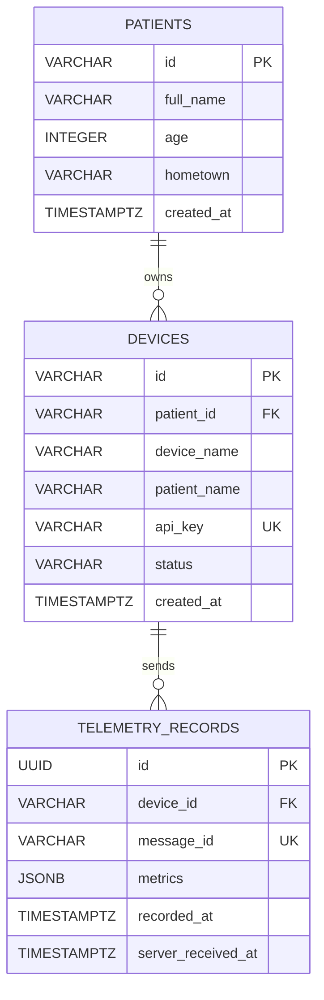

# Data Schema

## Sơ đồ quan hệ

`telemetry_records.metrics` lưu nhiều chỉ số trong một payload bằng `JSONB`.
`devices.api_key` là key riêng của device để gửi telemetry vào ingestion API.

## Bảng `patients`

| Cột | Kiểu dữ liệu | Ràng buộc / Index | Mô tả |
|---|---|---|---|
| `id` | `VARCHAR` | **PK** | Định danh bệnh nhân |
| `full_name` | `VARCHAR` |  | Họ và tên |
| `age` | `INTEGER` | `CHECK 0..150` | Tuổi bệnh nhân |
| `hometown` | `VARCHAR` |  | Quê quán |
| `created_at` | `TIMESTAMPTZ` | `DEFAULT NOW()` | Thời điểm tạo hồ sơ |

## Bảng `devices`

| Cột | Kiểu dữ liệu | Ràng buộc / Index | Mô tả |
|---|---|---|---|
| `id` | `VARCHAR` | **PK** | Định danh thiết bị |
| `patient_id` | `VARCHAR` | Index | Bệnh nhân sở hữu thiết bị |
| `device_name` | `VARCHAR` |  | Tên hiển thị thiết bị |
| `patient_name` | `VARCHAR` |  | Tên hiển thị denormalized cho seed/list |
| `api_key` | `VARCHAR` | **Unique Index** | Xác thực ingestion của device; không trả về portal |
| `status` | `VARCHAR` |  | Trạng thái thiết bị |
| `created_at` | `TIMESTAMPTZ` | `DEFAULT NOW()` | Thời điểm tạo thiết bị |

## Bảng `telemetry_records`

| Cột | Kiểu dữ liệu | Ràng buộc / Index | Mô tả |
|---|---|---|---|
| `id` | `UUID` | **PK** | Định danh bản ghi đo |
| `device_id` | `VARCHAR` | **FK**, Index | Thiết bị gửi dữ liệu |
| `message_id` | `VARCHAR` | **Unique Index** | Chống ghi trùng bản tin |
| `metrics` | `JSONB` |  | Mảng chỉ số như `HEART_RATE`, `SPO2` |
| `recorded_at` | `TIMESTAMPTZ` | Index | Thời điểm thiết bị ghi nhận |
| `server_received_at` | `TIMESTAMPTZ` | `DEFAULT NOW()` | Thời điểm server nhận |

## Quy tắc dữ liệu

- `X-API-Key` xác định device; `deviceId` trong payload là optional và nếu có phải khớp key.
- `api_key` không được expose qua các endpoint portal.
- Mỗi `telemetry_records.device_id` phải tham chiếu đến một device hợp lệ.
- `message_id` là duy nhất để hỗ trợ idempotency.
- `recorded_at` và `server_received_at` lưu kèm timezone.
