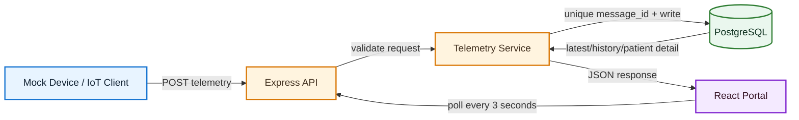

# System Architecture Flow

## Runtime Services

| Service       | Responsibility                          | Local port |
| ------------- | --------------------------------------- | ---------: |
| `db`          | PostgreSQL persistence                  |     `5432` |
| `backend`     | Ingestion API and patient portal API    |     `3000` |
| `mock-device` | Sends telemetry every 3 seconds         |   internal |
| `frontend`    | React production bundle served by Nginx |     `8080` |
